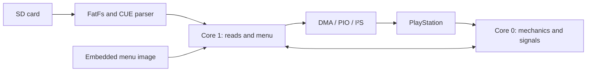

# Architecture and protocol

The project combines Arm firmware for the RP2040/RP2350 with a MIPS menu that runs on the PlayStation. The default build compiles the menu, creates a disc image, and embeds it in the firmware. The SD card provides game images and optional menu files.

Core 0 handles drive mechanics, reset, and console signals. Core 1 handles SD reads, menu commands, and sector transfers. Communication between them uses the existing synchronization; the data path and several routines are timing-sensitive. Startup sets the system clock to 271.2 MHz and starts both cores.

## Layout

| Path | Responsibility |
| --- | --- |
| `src/main.cpp`, `src/drive/` | Startup, commands, and mechanics |
| `src/storage/`, `src/disc/` | Listing, CUE/BIN, sectors, EDC, and Q subchannel |
| `src/hardware/`, `pio/` | I²S/DMA, modchip, SI5351, and PIO programs |
| `src/menu/`, `include/menu/`, `assets/menu/` | PlayStation menu code and assets |
| `include/menu_protocol.h` | Shared protocol constants |
| `boards/` | Variants and pin maps; generates `picostation_pinout.h` |
| `cmake/`, `scripts/` | Firmware, menu, and release package builds |
| `third_party/`, `binary/`, `tools/` | Dependencies, bundled binaries, and tools |
| `openspec/` | Project specifications and changes |

## Menu communication

The menu requests index preparation before confirming a mount. The firmware keeps the menu image active while it validates the candidate disc; the response contains `MNT1`, the index, the FatFs result, and an audio-only disc flag. A prepared image is only confirmed for the same index. The return command restores the menu image.

| Content | Protocol reference |
| --- | --- |
| Prepare / return | Commands `0xB` / `0xC` |
| Mount state | LBA 110; `MNT1`, index, and 16-bit little-endian result; audio flag at offset 8 |
| Configuration | LBA 150; up to 2048 bytes, `CFG1` marker |
| Covers | Starting at LBA 200; `PART`, and `RGB5` for RGB555 |
| Missing optional file | `DEAD` marker |
| Listing | End 0, continuation 1, missing card 2, read error 3, open error 4 |

See [menu_protocol.h](../include/menu_protocol.h), [i2s.cpp](../src/hardware/i2s.cpp), and [directory_listing.cpp](../src/storage/directory_listing.cpp) for details. Changes to this contract must preserve firmware-menu compatibility; validate the built pair and any prebuilt binary you use.

## Startup and execution

[`main.cpp`](../src/main.cpp) raises the regulator to 1.15 V, waits 100 ms, sets the system clock to 271.2 MHz, initializes the synchronization primitives and EDC/ECC tables, and initializes the hardware. It launches `core1Entry` on core 1 and enters `core0Entry` on core 0. The initial sector limit is 333000; loading a disc can update it. The system clock is distinct from the profile-specific Mechacon clock described in [build.md](build.md).

Core 0 receives console control signals through GPIO and PIO interrupts, decodes latched Mechacon commands, models sled movement and drive state, and schedules Q subchannel output. Core 1 owns the storage and streaming work: it reads or synthesizes sectors, prepares DMA buffers and handles menu requests. PIO and DMA deliver the sector stream to the console in synchronization with LRCK. The sector start timestamp is shared with the subchannel scheduler; its placement around the DMA trigger affects timing. Shared state and the disc-publication pause coordinate the cores. Functions marked `__time_critical_func` and interrupt handlers must be reviewed for latency as well as correctness.

With SD boot diagnostics enabled, the firmware also records disc events and a 45-second DMA trace to the card for post-mortem analysis. Reading that trace is described in [validation.md](validation.md).

## From selection to playback

1. The menu requests a directory page. `DirectoryListing` mounts FatFs when necessary, enumerates visible entries, and returns names and a terminator indicating whether another page or an error follows. Enumeration is bounded at 4096 visible entries. Opening a folder changes the current path; selecting a CUE starts preparation.
2. `DiscImage::load` parses the CUE into a candidate, resolves its track files relative to the CUE, and validates the file sizes and first data track descriptor. A failure releases candidate resources and reports a FatFs result; it does not replace the active menu image.
3. The menu reads the mount status and confirms the same prepared index. Publication coordinates a pause with core 0, transfers ownership of the prepared track handles, updates the active image and sector limit, and releases the old image. This avoids exposing partially initialized track data to the streaming path. `replacePreparedImage` clears transferred pointers in place to avoid a large temporary on the core 1 stack.
4. The console reads the selected image as a disc. The menu identifies the game where possible and selects fast or regular boot. A return command restores the embedded menu; a lid cycle can select another image while retaining the selected read options.

The exact state transitions and wire representation are implemented in [`i2s.cpp`](../src/hardware/i2s.cpp), [`directory_listing.cpp`](../src/storage/directory_listing.cpp), and [`menu_protocol.h`](../include/menu_protocol.h). The status sector is a protocol response, not a general-purpose file on the card.

### Fast reboot and the kernel handoff

Fast and regular boot differ in how the running menu returns control to the BIOS. `softReset()` disables interrupts and jumps to the full BIOS entry point, which reinitializes the machine as at power-on. `softFastReboot()` first checks the BIOS ROM signature and falls back to the full entry point on custom kernels, then copies a breakpoint stub to the COP0 breakpoint vector and a dummy shell to the shell load address. A data-write breakpoint on the shell load address makes the BIOS abort the shell relocation; the dummy shell returns immediately and the kernel proceeds to boot the disc instead.

The fast path enters at the alternate BIOS entry point, in the middle of the boot code, and therefore skips the stage that initializes the caches — above all the instruction cache, which still holds code cached from the previous boot and from the menu runtime; executing the new kernel over stale I-cache lines produces garbage. The menu invalidates the I-cache by hand before configuring the breakpoint: it programs the cache control register (`0xfffe0130`) into I-cache tag test mode, so that data stores hit the I-cache tag array instead of memory, sets the isolate-cache bit in SR so nothing writes through to RAM, and sweeps one full cache size with zero stores, invalidating every line. SR and the cache control register are restored before returning, and the routine executes from its uncached kseg1 mirror. A literal RAM wipe of the kernel region is not an equivalent substitute: zeroing live kernel structures under the running menu stalls the warm boot even earlier than leaving them stale. [`system.c`](../src/menu/psxproject/system.c) and [`system.s`](../src/menu/psxproject/system.s) implement the sequence.

## Sector construction and recovery

The image reader converts the requested sector to a position relative to the pregap, locates its track, and translates it to a byte offset in the corresponding 2352-byte-sector file. Synthetic pregaps and areas outside stored data are constructed instead of read. The embedded menu is served from `loaderImage`; when Bootsector Fix is enabled, the first five sectors of a data disc can also be substituted from that image. Audio and data have different processing requirements.

With EDC correction enabled, data-track reads pass through `eccedc_generate` before scrambling: sync is rebuilt, the duplicated Mode 2 subheader is resynchronized, and Mode 1 and Mode 2 Form 1 sectors have EDC and P/Q parity recomputed — unconditionally for Form 1, because parity can be damaged even when the EDC matches. Mode 2 Form 2 sectors with submode exactly `0x20` keep a zeroed or standard (`0x3F13B0BE`) EDC tail untouched; only other Form 2 payloads have the EDC computed. The preserved zeroed tail matches the mastering artifact shipped on original pressed discs, whose reserved license sectors carry a zero EDC; some games (the DDR family) verify it, so regeneration there would break them. Disabling correction follows the direct read path and serves the stored bytes unchanged, so images that differ in these byte ranges can behave differently between the two paths and toggling the correction is a valid diagnostic step.

On eligible storage errors the reader attempts to reopen a track and retry, with recovery attempts rate-limited to 250 ms. If a sector still fails, it clears the output buffer and reports failure rather than replaying stale data. A successful initial CUE validation checks structure and a descriptor, not every sector or the correctness of the entire image. [`disc_image.cpp`](../src/storage/disc_image.cpp) and [`edc.c`](../src/disc/edc.c) define the actual transformations.

Q subchannel generation derives track, index, and relative and absolute positions from the active disc. The absolute time in the program area is anchored at `sector - c_leadIn`, which equals `LBA + c_preGap`: LBA 0 is reported as MSF `00:02:00`, matching the Red Book program-area origin. An offset added to this value shifts every reported position and desynchronizes the subchannel lock the console uses during seeks and reads. Core 0 schedules Q output relative to sector delivery, so an apparently valid sector stream can still fail on hardware if subcode timing or content is wrong. Pregap limitations and pending captures are documented in [validation.md](validation.md).

## Menu and disc data transport

The menu is a separate PlayStation executable, built into a disc image embedded in firmware. Its controller, rendering, CD access and file manager run on the console; the Pico supplies both ordinary disc sectors and reserved protocol responses. Commands select operations, while reads from reserved LBAs return status, configuration or cover data. The shared constants define offsets within raw reads: a raw response is 2340 bytes after the 12-byte sync, and individual payload formats have their own offsets. Do not interpret these offsets as file offsets in a BIN image.

Configuration is bounded to 2048 bytes. Indexed covers carry a 512-byte palette and 128 × 128 indices in parts of up to 2114 bytes; RGB555 covers carry 32768 bytes in sixteen 2048-byte parts. Missing optional files are signaled with `DEAD`. The menu and firmware must agree on markers, offsets, command values and interpretation; a successful firmware build alone does not establish compatibility with an independently built menu.

## Hardware and build boundaries

Board CMake files define GPIO assignments and generate `picostation_pinout.h`. PIO programs in [`main.pio`](../pio/main.pio) implement timing-sensitive hardware interfaces; [`picostation.cpp`](../src/drive/picostation.cpp) configures them along with GPIO, PWM and interrupts. The optional SI5351 and modchip support reside in `src/hardware`. Profile selection is a build-time decision, not automatic detection of the console board. Consult the profile and wiring before flashing or connecting hardware.
