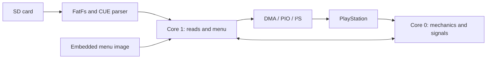

# Architecture and protocol

The project combines Arm firmware for the RP2040/RP2350 with a MIPS menu that runs on the PlayStation. The default build compiles the menu, creates a disc image, and embeds it in the firmware. The SD card provides game images and optional menu files.

Core 0 handles drive mechanics, reset, and console signals. Core 1 handles SD reads, menu commands, and sector transfers. Communication between them uses the existing synchronization; the data path and several routines are timing-sensitive. Startup sets the system clock to 271.2 MHz and starts both cores.

## Layout

| Path | Responsibility |
| --- | --- |
| `src/main.cpp`, `src/drive/` | Startup, commands, and mechanics |
| `src/storage/`, `src/disc/` | Listing, CUE/BIN, sectors, EDC, and Q subchannel |
| `src/hardware/`, `pio/` | I²S/DMA, modchip, SI5351, and PIO programs |
| `src/menu/`, `include/menu/`, `assets/menu/` | PlayStation menu code and assets |
| `include/menu_protocol.h` | Shared protocol constants |
| `boards/` | Variants and pin maps; generates `picostation_pinout.h` |
| `cmake/`, `scripts/` | Firmware, menu, and release package builds |
| `third_party/`, `binary/`, `tools/` | Dependencies, bundled binaries, and tools |
| `openspec/` | Project specifications and changes |

## Menu communication

The menu requests index preparation before confirming a mount. The firmware keeps the menu image active while it validates the candidate disc; the response contains `MNT1`, the index, the FatFs result, and an audio-only disc flag. A prepared image is only confirmed for the same index. The return command restores the menu image.

| Content | Protocol reference |
| --- | --- |
| Prepare / return | Commands `0xB` / `0xC` |
| Mount state | LBA 110; `MNT1`, index, and 16-bit little-endian result; audio flag at offset 8 |
| Configuration | LBA 150; up to 2048 bytes, `CFG1` marker |
| Covers | Starting at LBA 200; `PART`, and `RGB5` for RGB555 |
| Missing optional file | `DEAD` marker |
| Listing | End 0, continuation 1, missing card 2, read error 3, open error 4 |

See [menu_protocol.h](../include/menu_protocol.h), [i2s.cpp](../src/hardware/i2s.cpp), and [directory_listing.cpp](../src/storage/directory_listing.cpp) for details. Changes to this contract must preserve firmware-menu compatibility; validate the built pair and any prebuilt binary you use.

## Startup and execution

[`main.cpp`](../src/main.cpp) raises the regulator to 1.15 V, waits 100 ms, sets the system clock to 271.2 MHz, initializes the synchronization primitives and EDC/ECC tables, and initializes the hardware. It launches `core1Entry` on core 1 and enters `core0Entry` on core 0. The initial sector limit is 333000; loading a disc can update it. The system clock is distinct from the profile-specific Mechacon clock described in [build.md](build.md).

Core 0 receives console control signals through GPIO and PIO interrupts, decodes latched Mechacon commands, models sled movement and drive state, and schedules Q subchannel output. Core 1 owns the storage and streaming work: it reads or synthesizes sectors, prepares DMA buffers and handles menu requests. PIO and DMA deliver the sector stream to the console in synchronization with LRCK. The sector start timestamp is shared with the subchannel scheduler; its placement around the DMA trigger affects timing. Shared state and the disc-publication pause coordinate the cores. Functions marked `__time_critical_func` and interrupt handlers must be reviewed for latency as well as correctness.

## From selection to playback

1. The menu requests a directory page. `DirectoryListing` mounts FatFs when necessary, enumerates visible entries, and returns names and a terminator indicating whether another page or an error follows. Enumeration is bounded at 4096 visible entries. Opening a folder changes the current path; selecting a CUE starts preparation.
2. `DiscImage::load` parses the CUE into a candidate, resolves its track files relative to the CUE, and validates the file sizes and first data track descriptor. A failure releases candidate resources and reports a FatFs result; it does not replace the active menu image.
3. The menu reads the mount status and confirms the same prepared index. Publication coordinates a pause with core 0, transfers ownership of the prepared track handles, updates the active image and sector limit, and releases the old image. This avoids exposing partially initialized track data to the streaming path. `replacePreparedImage` clears transferred pointers in place to avoid a large temporary on the core 1 stack.
4. The console reads the selected image as a disc. The menu identifies the game where possible and selects fast or regular boot. A return command restores the embedded menu; a lid cycle can select another image while retaining the selected read options.

The exact state transitions and wire representation are implemented in [`i2s.cpp`](../src/hardware/i2s.cpp), [`directory_listing.cpp`](../src/storage/directory_listing.cpp), and [`menu_protocol.h`](../include/menu_protocol.h). The status sector is a protocol response, not a general-purpose file on the card.

## Sector construction and recovery

The image reader converts the requested sector to a position relative to the pregap, locates its track, and translates it to a byte offset in the corresponding 2352-byte-sector file. Synthetic pregaps and areas outside stored data are constructed instead of read. The embedded menu is served from `loaderImage`; when Bootsector Fix is enabled, the first five sectors of a data disc can also be substituted from that image. Data reads can regenerate EDC/ECC before scrambling; disabling correction follows the direct read path. Audio and data have different processing requirements.

On eligible storage errors the reader attempts to reopen a track and retry, with recovery attempts rate-limited to 250 ms. If a sector still fails, it clears the output buffer and reports failure rather than replaying stale data. A successful initial CUE validation checks structure and a descriptor, not every sector or the correctness of the entire image. [`disc_image.cpp`](../src/storage/disc_image.cpp) and [`edc.c`](../src/disc/edc.c) define the actual transformations.

Q subchannel generation derives track, index, and relative and absolute positions from the active disc. Core 0 schedules it relative to sector delivery, so an apparently valid sector stream can still fail on hardware if subcode timing is wrong. Pregap limitations and pending captures are documented in [validation.md](validation.md).

## Menu and disc data transport

The menu is a separate PlayStation executable, built into a disc image embedded in firmware. Its controller, rendering, CD access and file manager run on the console; the Pico supplies both ordinary disc sectors and reserved protocol responses. Commands select operations, while reads from reserved LBAs return status, configuration or cover data. The shared constants define offsets within raw reads: a raw response is 2340 bytes after the 12-byte sync, and individual payload formats have their own offsets. Do not interpret these offsets as file offsets in a BIN image.

Configuration is bounded to 2048 bytes. Indexed covers carry a 512-byte palette and 128 × 128 indices in parts of up to 2114 bytes; RGB555 covers carry 32768 bytes in sixteen 2048-byte parts. Missing optional files are signaled with `DEAD`. The menu and firmware must agree on markers, offsets, command values and interpretation; a successful firmware build alone does not establish compatibility with an independently built menu.

## Hardware and build boundaries

Board CMake files define GPIO assignments and generate `picostation_pinout.h`. PIO programs in [`main.pio`](../pio/main.pio) implement timing-sensitive hardware interfaces; [`picostation.cpp`](../src/drive/picostation.cpp) configures them along with GPIO, PWM and interrupts. The optional SI5351 and modchip support reside in `src/hardware`. Profile selection is a build-time decision, not automatic detection of the console board. Consult the profile and wiring before flashing or connecting hardware.
