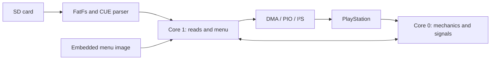

# Architecture and protocol

The project combines Arm firmware for the RP2040/RP2350 with a MIPS menu that runs on the PlayStation. The default build compiles the menu, creates a disc image, and embeds it in the firmware. The SD card provides game images and optional menu files.

Core 0 handles drive mechanics, reset, and console signals. Core 1 handles SD reads, menu commands, and sector transfers. Communication between them uses the existing synchronization; the data path and several routines are timing-sensitive. Startup sets the system clock to 271.2 MHz and starts both cores.

## Layout

| Path | Responsibility |
| --- | --- |
| `src/main.cpp`, `src/drive/` | Startup, commands, and mechanics |
| `src/storage/`, `src/disc/` | Listing, CUE/BIN, sectors, EDC, and Q subchannel |
| `src/hardware/`, `pio/` | I²S/DMA, modchip, SI5351, and PIO programs |
| `src/menu/`, `include/menu/`, `assets/menu/` | PlayStation menu code and assets |
| `include/menu_protocol.h` | Shared protocol constants |
| `boards/` | Variants and pin maps; generates `picostation_pinout.h` |
| `cmake/`, `scripts/` | Firmware, menu, and release package builds |
| `third_party/`, `binary/`, `tools/` | Dependencies, bundled binaries, and tools |
| `openspec/` | Project specifications and changes |

## Menu communication

The menu requests index preparation before confirming a mount. The firmware keeps the menu image active while it validates the candidate disc; the response contains `MNT1`, the index, the FatFs result, and an audio-only disc flag. A prepared image is only confirmed for the same index. The return command restores the menu image.

| Content | Protocol reference |
| --- | --- |
| Prepare / return | Commands `0xB` / `0xC` |
| Mount state | LBA 110; `MNT1`, index, and 16-bit little-endian result; audio flag at offset 8 |
| Configuration | LBA 150; up to 2048 bytes, `CFG1` marker |
| Covers | Starting at LBA 200; `PART`, and `RGB5` for RGB555 |
| Missing optional file | `DEAD` marker |
| Listing | End 0, continuation 1, missing card 2, read error 3, open error 4 |

See [menu_protocol.h](../include/menu_protocol.h), [i2s.cpp](../src/hardware/i2s.cpp), and [directory_listing.cpp](../src/storage/directory_listing.cpp) for details. Changes to this contract must preserve firmware-menu compatibility; validate the built pair and any prebuilt binary you use.
