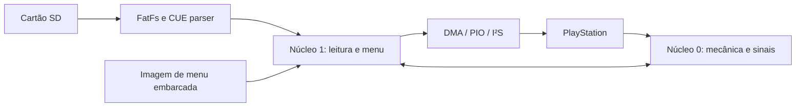

# Arquitetura e protocolo

O projeto combina um firmware Arm para RP2040/RP2350 com um menu MIPS executado no PlayStation. O build padrão compila o menu, cria uma imagem de disco e a incorpora ao firmware. O cartão SD fornece imagens de jogos e arquivos opcionais do menu.

O núcleo 0 trata a mecânica do drive, reset e sinais do console. O núcleo 1 trata leitura do SD, comandos do menu e transferência de setores. A comunicação entre eles usa a sincronização existente; o caminho de dados e várias rotinas são sensíveis a temporização. A inicialização configura o clock de sistema em 271,2 MHz e inicia os dois núcleos.

## Organização

| Caminho | Responsabilidade |
| --- | --- |
| `src/main.cpp`, `src/drive/` | Inicialização, comandos e mecânica |
| `src/storage/`, `src/disc/` | Listagem, CUE/BIN, setores, EDC e subcanal Q |
| `src/hardware/`, `pio/` | I²S/DMA, modchip, SI5351 e programas PIO |
| `src/menu/`, `include/menu/`, `assets/menu/` | Código e recursos do menu PlayStation |
| `include/menu_protocol.h` | Constantes compartilhadas do protocolo |
| `boards/` | Variantes e mapas de pinos; gera `picostation_pinout.h` |
| `cmake/`, `scripts/` | Build do firmware, menu e pacote de release |
| `third_party/`, `binary/`, `tools/` | Dependências, binários incluídos e ferramentas |
| `openspec/` | Especificações e mudanças do projeto |

## Comunicação do menu

O menu solicita a preparação de um índice antes de confirmar a montagem. O firmware mantém a imagem do menu ativa enquanto valida o disco candidato; a resposta contém `MNT1`, índice, resultado FatFs e indicação de disco somente de áudio. Uma imagem preparada só é confirmada para o mesmo índice. O comando de retorno restaura a imagem do menu.

| Conteúdo | Referência no protocolo |
| --- | --- |
| Preparar / retornar | Comandos `0xB` / `0xC` |
| Estado de montagem | LBA 110; `MNT1`, índice e resultado de 16 bits little-endian; flag de áudio no offset 8 |
| Configuração | LBA 150; até 2048 bytes, marcador `CFG1` |
| Capas | A partir de LBA 200; `PART`, e `RGB5` para RGB555 |
| Ausência de arquivo opcional | Marcador `DEAD` |
| Listagem | Fim 0, continuação 1, cartão ausente 2, erro de leitura 3, erro de abertura 4 |

Consulte [menu_protocol.h](../include/menu_protocol.h), [i2s.cpp](../src/hardware/i2s.cpp) e [directory_listing.cpp](../src/storage/directory_listing.cpp) para os detalhes. Alterações nesse contrato devem preservar a compatibilidade entre firmware e menu; valide o par compilado e qualquer binário precompilado utilizado.
