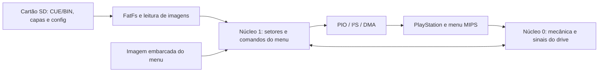

# Design

## Context

Retrato do checkout no commit `c379b53`, em 20/11/2026, obtido por inspeção estática. A motivação e o escopo estão em [proposal.md](proposal.md). Os cenários das specs descrevem contratos observados no código; não são resultados de testes executados.

### Arquitetura atual

O PicoStation EX é um ODE para o PlayStation original. O README declara compatibilidade com PU-8/SCPH-100x e PU-18/SCPH-55xx e recomenda SD em exFAT. O firmware usa C++20 e C; o menu é um programa MIPS executado pelo console.

| Área | Situação observada | Evidência na raiz do repositório |
| --- | --- | --- |
| Inicialização | Tensão de 1,15 V, espera de 100 ms e clock de sistema de 271,2 MHz; inicializa sincronização e EDC antes dos núcleos | `src/main.cpp` |
| Núcleo 0 | Mecânica, reset e sinais do drive; caminhos sensíveis a temporização | `src/drive/picostation.cpp`, `src/drive/drive_mechanics.cpp`, `src/drive/cmd.cpp` |
| Núcleo 1 | Leitura de setores, comandos do menu, preparação da imagem e transferência por buffers/DMA | `src/hardware/i2s.cpp` |
| Armazenamento | FatFs, CUE parser, resolução de arquivos, listagens e leitura de capas/configuração | `src/storage/`, `third_party/SD-fatfs/`, `third_party/cueparser/` |
| Disco | Construção de setores, EDC e subcanal Q | `src/storage/disc_image.cpp`, `src/disc/` |
| Interface | Navegador, janela de boot, estados de erro, cores e capas | `src/menu/main.c`, `src/menu/file_manager.c`, `src/menu/menu_media.c` |
| Game ID | Leitura de SYSTEM.CNF e identificação alternativa por data para PSX.EXE | `src/menu/menu_game_id.c` |
| Hardware | Pinout por variante, cabeçalho gerado e programas PIO | `boards/`, `pio/main.pio` |

### Compilação e distribuição

O [CMake principal](../../../CMakeLists.txt) exige 3.24.1 para firmware com menu precompilado e 3.25 para o fluxo padrão com menu da fonte. A configuração referencia Pico SDK 2.1.1. O fluxo padrão também exige GNU Arm, GNU MIPS, Python 3.10+ e mkpsxiso, com ferramentas auxiliares Python do runtime do menu.

1. `cmake/menu/` compila o menu MIPS e gera `.psexe`, `.bin` e `.cue` no diretório de build do menu.
2. O build Arm incorpora a imagem `.bin` como `loaderImage`, acompanhada de seu tamanho.
3. O Pico SDK gera o `.uf2` da variante.
4. `scripts/build-release.cmake` compila quatro perfis RC5 e usa ps1-packer e `cmake/pico-booty/` para produzir o quinto UF2 com o mesmo executável do menu PU8.

| Família | Variantes | Destino |
| --- | --- | --- |
| PicoStation | `picostation_pico1`, `picostation_pico2` | RP2040 / RP2350 |
| PicoStation Plus | `picostation_plus_pico1`, `picostation_plus_pico2` | RP2040 / RP2350, pinout Plus |
| RC5 | `picostationex_PU8`, `picostationex_PU8_OC`, `picostationex_PU18`, `picostationex_PU18_OC` | RP2040, pinout padrão e clock Mechacon em GP3 |
| Pico Booty | Build separado em `cmake/pico-booty/` | Segundo RP2040 na porta de expansão |

Os perfis RC5 usam períodos 68/42/64/36 para os clocks PU8/PU8_OC/PU18/PU18_OC. Os perfis OC também alteram os parâmetros de sled e SCEX. Esses clocks são distintos do clock de sistema de 271,2 MHz. A baseline não modifica GPIOs ou instruções de instalação.

As dependências locais incluem FatFs, cueparser, RP2040_Pseudo_Atomic, ps1-bare-metal e pico_booty. `.gitmodules` contém declarações históricas, mas `git submodule status` não listou submódulos neste checkout; há fontes de dependências rastreadas como arquivos comuns. A presença desse arquivo não comprova que ele prepara todas as dependências necessárias.

### Contratos entre menu e firmware

| Contrato | Valores observados | Evidência |
| --- | --- | --- |
| Preparação | Comando `0xB`; resposta `MNT1` no LBA 110; índice e FRESULT little-endian de 16 bits; flag áudio no offset 8 | `include/menu_protocol.h`, `src/hardware/i2s.cpp` |
| Confirmação | Publica a imagem preparada somente quando o índice coincide | `src/hardware/i2s.cpp` |
| Retorno | Comando `0xC` restaura a imagem do menu | `include/menu_protocol.h`, `src/hardware/i2s.cpp` |
| Listagem | Estados 0 fim, 1 continuação, 2 sem cartão, 3 erro de leitura, 4 erro de abertura | `include/menu_protocol.h`, `src/storage/directory_listing.cpp` |
| Configuração | LBA 150, até 2048 bytes e marcador `CFG1` | `include/menu_protocol.h`, `src/storage/directory_listing.cpp` |
| Capas | A partir do LBA 200, marcador `PART`; RGB555 usa também `RGB5`; ausência usa `DEAD` | `src/storage/directory_listing.cpp`, `src/menu/menu_media.c` |

A preparação valida estrutura, arquivos raw de 2352 bytes e o descritor ISO9660 quando a primeira faixa é de dados. Isso não é uma verificação integral de todo o conteúdo do disco: por exemplo, tamanho múltiplo de 2352 não garante ausência de truncamento em fronteira de setor. A identificação PlayStation ocorre no menu após a montagem. Na rotina de boot, áudio segue reset normal; a ausência da assinatura com leitura concluída também segue reset normal, enquanto uma falha de leitura aciona retorno ao menu. Os dois executáveis devem compartilhar o mesmo contrato.

### Lacunas e limites conhecidos

| Achado | Consequência para esta baseline |
| --- | --- |
| README menciona SDK usado na CI, mas não há workflow rastreado em `.github/` | SDK 2.1.1 é referência de configuração; não há execução de CI comprovada nesta análise |
| README aponta para `docs/menu.md`, ausente no inventário rastreado | Origem/créditos precisam de reconciliação documental posterior |
| README descreve somente capas indexadas | Código e `.ai-framework/DESIGN.md` também implementam RGB555; ambos entram nas specs |
| README atribui a validação da assinatura PlayStation ao firmware antes de iniciar | A baseline distingue preparação no firmware da identificação posterior no menu |
| Regras locais listam quatro variantes básicas | CMake também reconhece quatro perfis RC5; ambos os grupos são documentados |
| Não foi localizada suíte própria de testes automatizados nos arquivos do projeto examinados | Cenários OpenSpec não equivalem a testes automatizados existentes |
| Cheats e ajuste de clock aparecem na interface | Mostram avisos; não constituem recursos funcionais de cheats ou ajuste dinâmico |

Não foram executadas compilações, gravações de UF2 ou sessões no console nesta atividade documental. Não se afirma compatibilidade comprovada para todas as combinações de placa, variante, cartão e imagem. Os binários em `binary/` existem, mas sua equivalência aos fontes atuais não foi verificada.

## Goals / Non-Goals

**Goals:** estabelecer contratos rastreáveis ao código e manter separados estado implementado, evidência de execução e pendências documentais. A cobertura comportamental fica nas quatro [specs](specs/); este design concentra estrutura e limites.

**Non-Goals:** reimplementar o firmware, corrigir bugs, adicionar CI, alterar pinout ou timing, reconstruir binários de referência ou certificar hardware.

## Decisions

1. **Baseline em uma mudança identificada.** Os requisitos são novos no OpenSpec, embora já implementados. Isso permite revisar a transcrição antes da incorporação. A alternativa de editar diretamente as specs principais eliminaria esse estágio de revisão.
2. **Quatro capacidades por comportamento.** Build, reprodução, navegação e experiência do menu podem evoluir separadamente. Uma spec por arquivo C/C++ acoplaria o contrato à organização interna; uma spec única dificultaria mudanças focadas.
3. **Código como evidência do funcionamento atual.** Divergências com README são registradas acima. Repetir somente a documentação existente perpetuaria omissões sobre RC5, RGB555 e o fluxo de montagem.
4. **Validação documental proporcional.** Validar sintaxe OpenSpec, coerência entre artefatos e rastreabilidade local. Builds e testes físicos não são necessários para criar o retrato documental e não serão presumidos como aprovados.

## Risks / Trade-offs

- [Inspeção estática não prova comportamento físico] → registrar cada validação futura por revisão PU, variante, imagem e resultado.
- [Contrato menu/firmware pode divergir de binário antigo] → manter o build conjunto como referência; validar explicitamente qualquer imagem precompilada usada.
- [Baseline envelhece com o código] → futuras mudanças devem identificar e atualizar as capacidades afetadas.
- [Documentação geral ainda contém lacunas] → manter os achados rastreáveis e tratar sua reconciliação sem mudar comportamento.

## Migration Plan

Após revisão, incorporar os quatro deltas a `openspec/specs/` pelo fluxo de sincronização/arquivamento. Conferir os propósitos e cenários resultantes e validar as specs principais antes de arquivar a mudança. Não há migração de dados, deploy ou alteração no cartão SD. Uma reversão documental deve ser feita por diff/revert das alterações correspondentes, preservando alterações posteriores.

Para uma futura qualificação funcional, executar builds das quatro variantes básicas e quatro perfis RC5, verificar o pacote com Pico Booty e registrar testes em PU-8/PU-18: Mode 1/2, áudio, BIN ausente/truncado, SD ausente/reinserido, pasta vazia, paginação, capas nos dois formatos e boot normal/rápido. Esta matriz está pendente, fora da entrega documental atual.
